# 🪸 Nudibranch: Reef Manager

A self-hosted, mobile-friendly app for saltwater aquarium keepers. Track water chemistry, livestock, equipment and maintenance for one tank or several, plan your next tank, and get alerts on your phone.

Built with **Python**, **Django 5**, **SQLite**, **Tailwind CSS**, **HTMX** and **Chart.js**, and installable on your phone as a **Progressive Web App**.

> **Keep it private.** Everything requires a sign-in, but this app isn't hardened for the public internet. Use [Tailscale](#-reaching-it-from-your-phone) to reach it from anywhere: it keeps the app private to your own devices. Just don't turn on Tailscale **Funnel**, which would put it on the public internet, and don't forward port 8000 on your router.

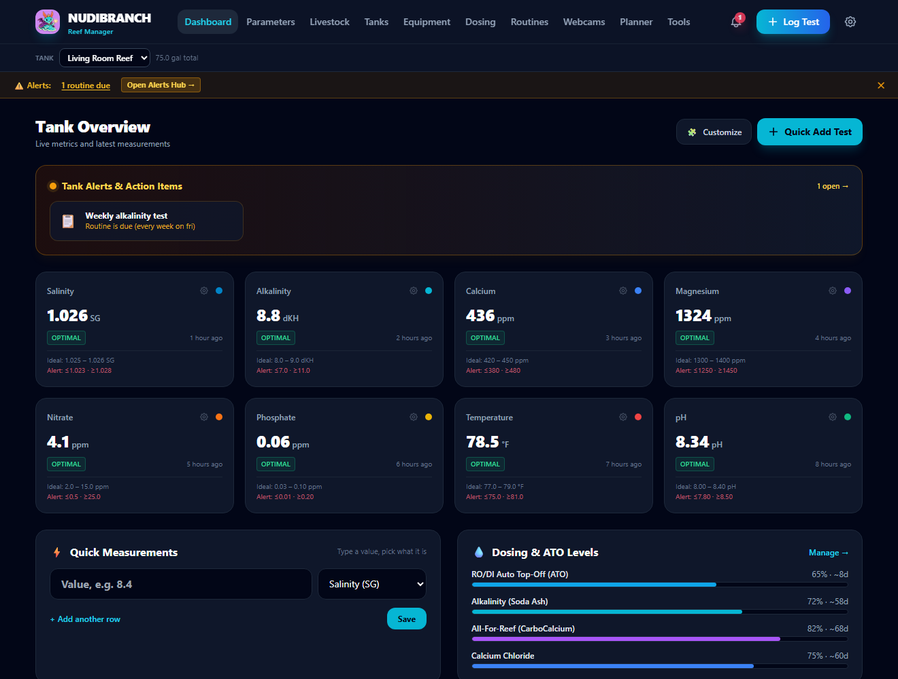

---

## 📸 Screenshots

| Water quality | Compare planned tanks |
|---|---|
| 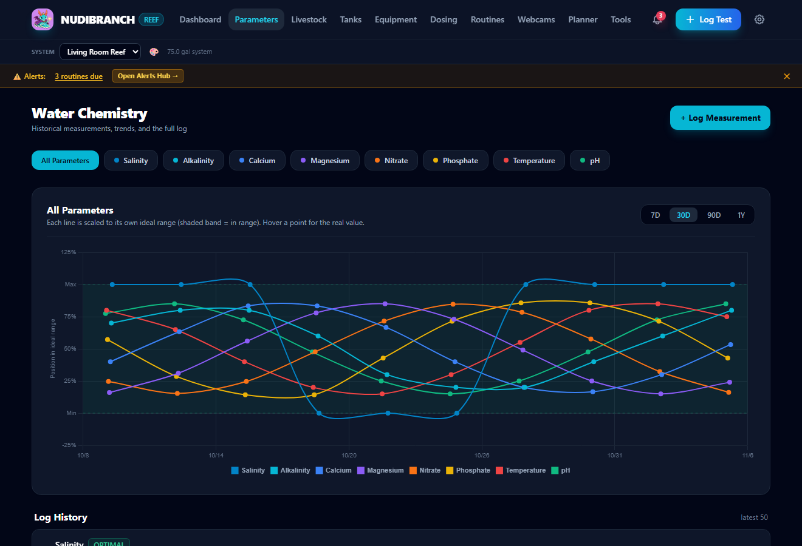 | 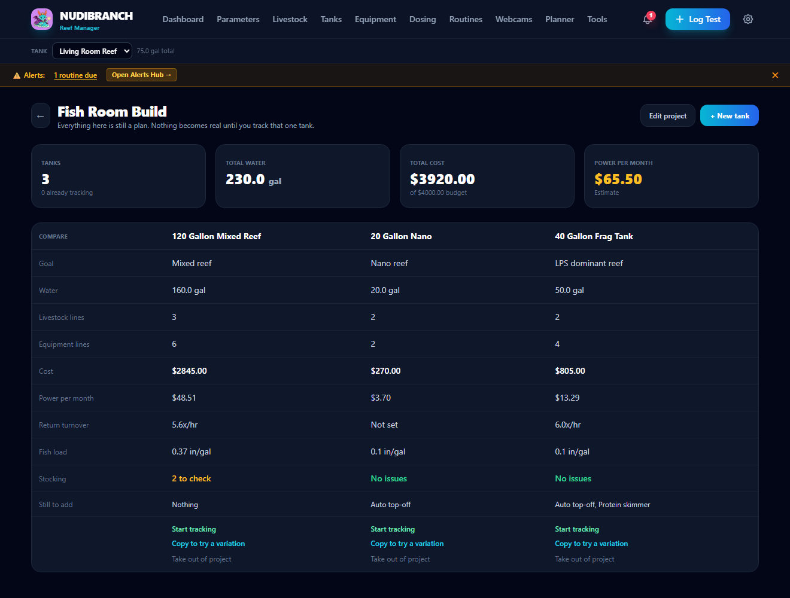 |

| Species catalog | Wishlist |
|---|---|
| 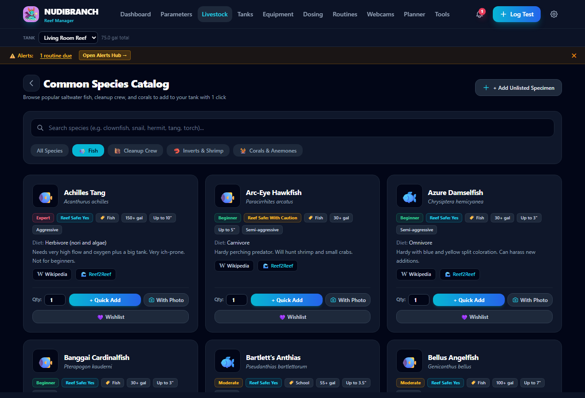 | 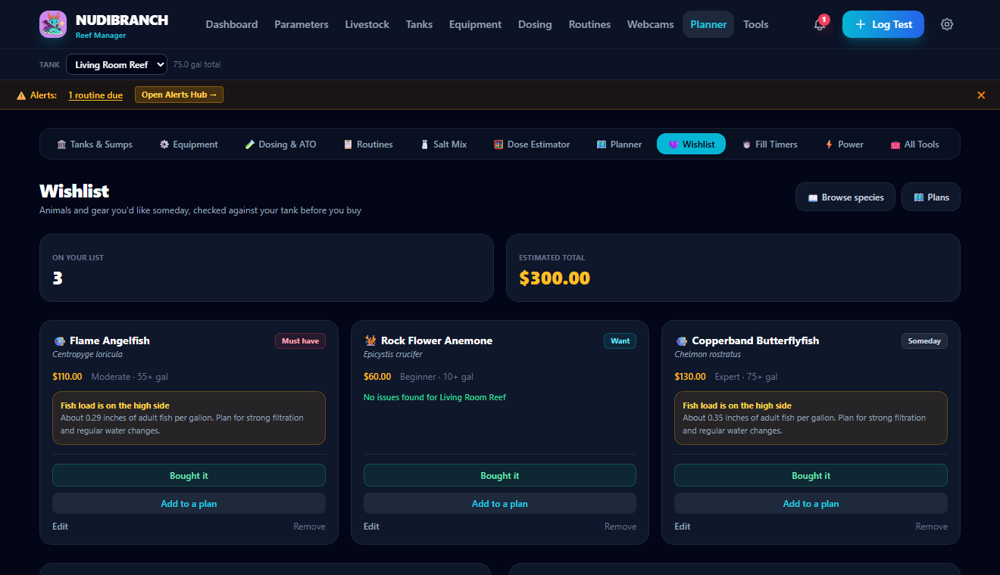 |

| Alerts, resolved history and mute | A timer on a routine's step |
|---|---|
| 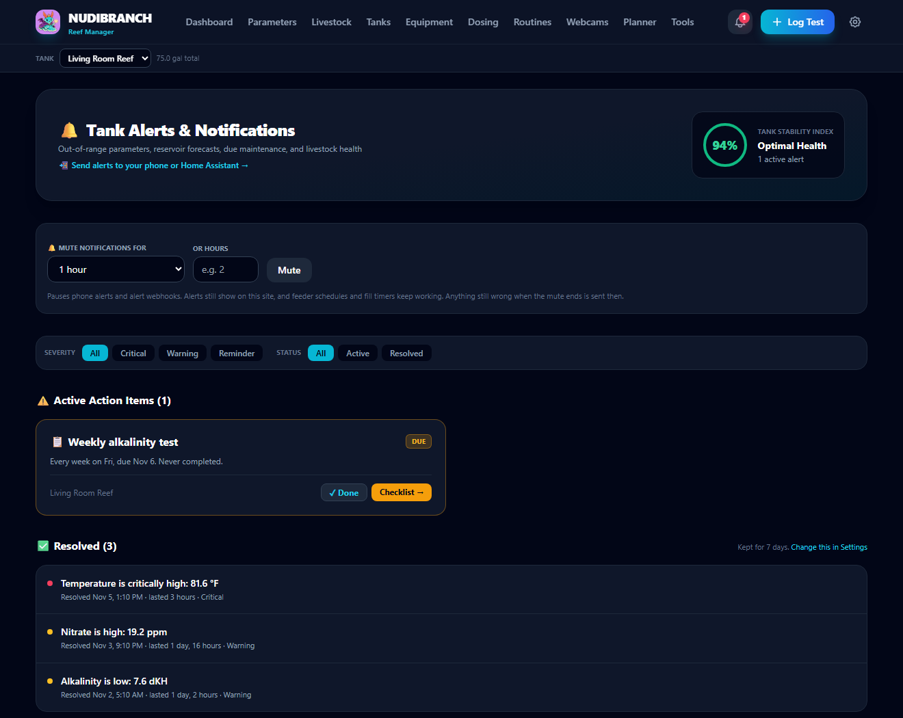 | 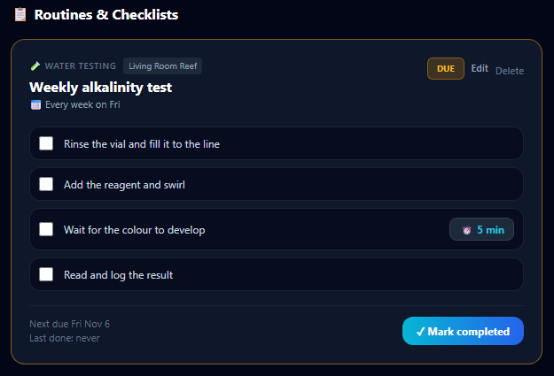 |

| Lighting and PAR estimate |
|---|
| 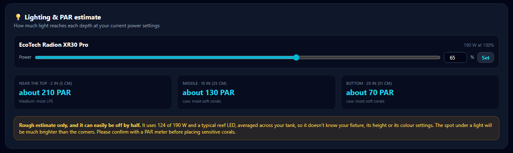 |

| Colours and characters | Fill timers | On your phone |
|---|---|---|
| 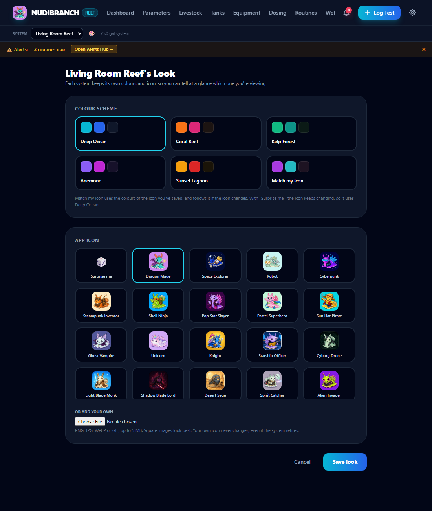 | 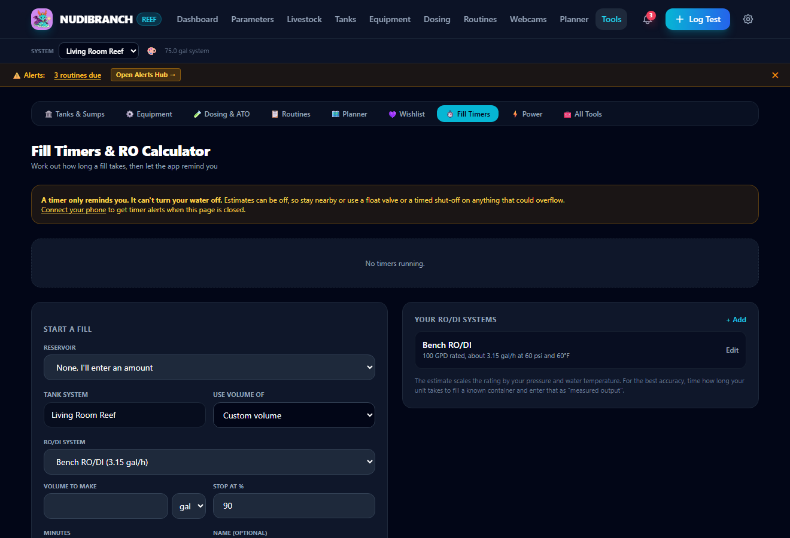 | 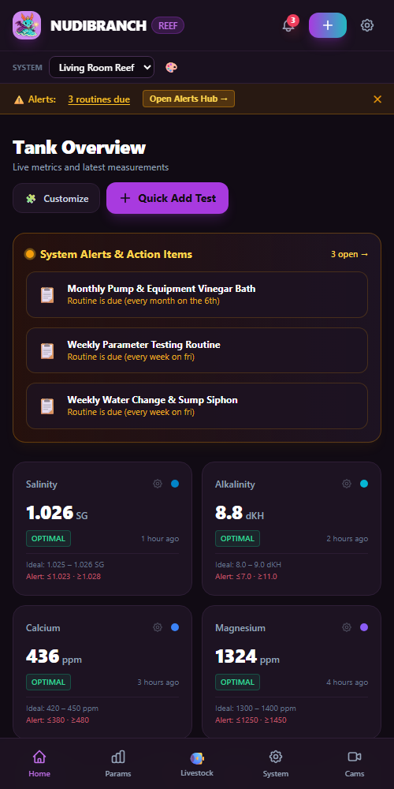 |

*Screenshots use sample data.*

---

## 🚀 Getting started

You need [Docker](https://www.docker.com/products/docker-desktop/) with Docker Compose. New to Docker? Skip to [step by step](#-new-to-docker-step-by-step) below.

1. Copy `.env.example` to `.env`, then fill in `DJANGO_SECRET_KEY` and `API_SECRET_KEY` with long random values. The file explains how. Git ignores `.env`, so it stays private.
2. From the project folder, run:

   ```bash
   docker compose up -d --build
   ```

3. Open **[http://localhost:8000](http://localhost:8000)** on the same computer. If there are no accounts yet, you'll be asked to create one.

Run the same command to apply updates. Database changes are applied on startup, and your data stays in the `data` folder.

Keep a private copy of your `.env` file, such as in a password manager. It isn't included in the app's backups.

### 🐣 New to Docker? Step by step

Docker runs Nudibranch in its own sealed box (a *container*) with everything it needs already inside, so you don't install Python or anything else yourself. Docker Compose is the part that reads `docker-compose.yml` and starts that box for you. You only need a handful of commands, and they're all below.

**1. Install Docker**

- **Windows 10 or 11:** download [Docker Desktop](https://www.docker.com/products/docker-desktop/) and run the installer. Keep the **WSL 2** option ticked if it asks, and restart your computer when it's done.
- **Mac:** download [Docker Desktop](https://www.docker.com/products/docker-desktop/). Pick **Apple silicon** for M1 or newer Macs, or **Intel** for older ones (Apple menu > About This Mac tells you which). Drag it to Applications and open it.
- **Linux:** install [Docker Engine](https://docs.docker.com/engine/install/) for your distribution, which includes the Compose plugin.

Open Docker Desktop once and wait until it says it's running. Leave it running whenever you want to use Nudibranch. To have it start by itself, tick **Start Docker Desktop when you sign in to your computer** in Docker Desktop's settings (the ⚙️ icon, then **General**).

**2. Open a terminal**

A terminal is a window where you type commands. Every command in this guide goes there, typed (or pasted) and then Enter.

- **Windows:** open the Start menu and type **Terminal** (or **PowerShell**).
- **Mac:** press Cmd + Space and type **Terminal**.

Check Docker is ready. Each command should print a version number:

```bash
docker --version
```

```bash
docker compose version
```

If you see "command not found" or "cannot connect to the Docker daemon", make sure Docker Desktop is open and running, then close the terminal and open a new one.

**3. Get Nudibranch**

On the project's GitHub page, click the green **Code** button, then **Download ZIP**. Unzip it somewhere easy to find, such as your Documents folder. (If you already use Git, `git clone` works too, and makes updating easier.)

Now point the terminal at that folder. Type `cd` and a space, drag the unzipped folder onto the terminal window, then press Enter. On Windows you can also right-click the folder in File Explorer and choose **Open in Terminal**.

**4. Make your private settings file**

The app's settings live in a file called `.env`. Make it from the example. On Windows (PowerShell):

```powershell
Copy-Item .env.example .env
```

On Mac or Linux:

```bash
cp .env.example .env
```

The app needs two long random passwords (keys) in that file. This command makes one, using Docker, so you don't need anything else installed. Run it twice, and keep both results for the next step:

```bash
docker run --rm python:3.12-alpine python -c "import secrets; print(secrets.token_urlsafe(50))"
```

Open `.env` to edit it, with `notepad .env` on Windows or `open -e .env` on a Mac. Then:

- Paste the first key after `DJANGO_SECRET_KEY=` and the second after `API_SECRET_KEY=`, with no spaces or quotes.
- Remove the `#` in front of `TIME_ZONE` and set your own, such as `TIME_ZONE=America/New_York` ([list of time zones](https://en.wikipedia.org/wiki/List_of_tz_database_time_zones), in the "TZ identifier" column).
- Save and close it.

Files starting with a dot are hidden in the Mac Finder. Press Cmd + Shift + . to show them. The `notepad` and `open -e` commands work either way.

**5. Start it**

```bash
docker compose up -d --build
```

The first time takes a few minutes while Docker downloads and builds everything. Later starts take seconds. `-d` means it keeps running in the background after you close the terminal, and `--build` uses the latest copy of the code.

**6. Open it**

Go to **[http://localhost:8000](http://localhost:8000)** in a browser on the same computer and create your account. To use it from your phone, at home or away, see [Reaching it from your phone](#-reaching-it-from-your-phone) next.

**Everyday commands** (run them in the project folder):

| To... | Run |
|---|---|
| See if it's running | `docker compose ps` |
| Watch what it's doing (Ctrl + C stops watching, not the app) | `docker compose logs -f web` |
| Stop it | `docker compose down` |
| Start it again | `docker compose up -d` |
| Update it | Get the new code (see below), then `docker compose up -d --build` |

**Updating from a ZIP:** unzip the new download over your existing folder, replacing the old files, so your `data` folder and `.env` stay where they are. If you unzip it somewhere new instead, copy `data` and `.env` across before starting it. With Git, `git pull` in the folder does all of this for you.

Stopping, updating or restarting your computer doesn't touch your tanks, tests and photos. They live in the `data` folder, so never delete that folder, and keep backups (**Tools > Backups**). The app starts again by itself whenever Docker Desktop is running.

**If something goes wrong**

- **"Copy .env.example to .env and set DJANGO_SECRET_KEY":** the `.env` file is missing, or the key is empty. Go back to step 4.
- **"port is already allocated":** another program is using port 8000. Close it, or restart your computer, and try again.
- **The page won't load:** give it a minute after starting, then check `docker compose ps` says it's running. `docker compose logs web` shows any error.
- **A form says it was rejected (CSRF):** the address in your browser isn't listed in `CSRF_TRUSTED_ORIGINS` in `.env`. Add it, then run `docker compose up -d`.

### Accounts

Every page, photo and backup needs a sign-in. You stay signed in for 30 days on each device, and **Sign out** is on the **Tools** page.

Forgot your password? Reset it from the project folder, replacing `YOUR-USERNAME`:

```bash
docker compose exec web python manage.py changepassword YOUR-USERNAME
```

### Settings

Set these in your `.env` file.

| Setting | What it does |
|---|---|
| `DJANGO_SECRET_KEY` | Required. The app won't start without it. |
| `API_SECRET_KEY` | The key devices must send to log readings. Without one, the logging API stays closed. |
| `CSRF_TRUSTED_ORIGINS` | The addresses you open the app from. Without yours, forms are rejected. |
| `BIND_ADDRESS` | `127.0.0.1` allows only this computer, which is the default. `0.0.0.0` allows your whole local network. |
| `TIME_ZONE` | Your time zone, used for schedules and log times, such as `Europe/London`. The default is `America/Regina`, so set yours. |

### 📱 Reaching it from your phone

There are two ways, and you can use both:

- **At home, on the same Wi-Fi:** a quick settings change, below. Your phone only reaches it while it's on your home network.
- **Anywhere, including away from home:** [Tailscale](#away-from-home-tailscale), below. It's also the only way to install Nudibranch on your phone as an app, because that needs HTTPS.

Out of the box, Nudibranch only answers on the computer it runs on, so neither works until you set one up.

#### At home: your local network

1. Find the computer's address on your network. On Windows, run `ipconfig` and look for **IPv4 Address**, such as `192.168.1.50`. On a Mac, it's under System Settings > Wi-Fi > **Details** next to your network, listed as **IP address**.
2. In `.env`, change `BIND_ADDRESS=127.0.0.1` to `BIND_ADDRESS=0.0.0.0`, and add that address to the end of `CSRF_TRUSTED_ORIGINS`, with `http://` and `:8000` around it:

   ```
   CSRF_TRUSTED_ORIGINS=http://localhost:8000,http://127.0.0.1:8000,http://192.168.1.50:8000
   ```

3. Run `docker compose up -d` to apply it.
4. On your phone, connected to the same Wi-Fi, open `http://192.168.1.50:8000` (with your own address) and sign in. Add it to your home screen as a bookmark if you like.

- **If it won't load:** the first time, Windows may ask whether to allow Docker through the firewall. Allow it on **private** networks. Also check your phone is on the home Wi-Fi, not mobile data or a guest network.
- **If the address changes:** your router can hand the computer a new address now and then, and the bookmark stops working. Most routers can reserve an address for one computer (often called a *DHCP reservation* or *static lease*).
- **Who else can reach it:** everything on your network can now reach the sign-in page, including guests and smart devices. Everything still needs your password, but if you'd rather not open it up, use Tailscale only and keep `BIND_ADDRESS=127.0.0.1`.

#### Away from home: Tailscale

To reach it from outside your home network, use [Tailscale](https://tailscale.com) rather than opening a port on your router. It's free for personal use, and its Serve feature gives you a private HTTPS address that only your own devices can reach. Install Tailscale on both devices, turn on **HTTPS** in the Tailscale admin console, and leave **Funnel** off. Then, on the computer running Nudibranch:

```bash
tailscale serve --bg 8000
```

Tailscale may ask you to approve Serve the first time. Add the `https://` address it shows to `CSRF_TRUSTED_ORIGINS` in `.env`, then run `docker compose up -d` again.

- **Install it on your phone:** open that address and use your browser's install or add to home screen option. Installing needs HTTPS, which this provides.
- **Keep Tailscale connected:** with the default `BIND_ADDRESS`, your phone needs Tailscale on even at home. If you've also set up the home network way above, you can use that address at home instead. A device using your phone's hotspot needs Tailscale too.
- **If it can't connect:** the app shows **Can't reach Nudibranch** with a **Try again** button, rather than an old saved copy of the page. That usually means Tailscale is off.
- **App icon:** the browser tab and the installed app use your main tank's icon. Browsers fetch the new icon the next time they load a page. On an iPhone, an icon already on the home screen keeps its old picture until you remove it and add it again.
- **Webcams:** cameras with local network addresses won't load away from home unless they're also reachable through Tailscale.

---

## ✨ Features

### Dashboard and getting around
- **On a phone,** the bar at the bottom has Home, Water, Livestock, Tanks and Tools. Calculators, timers, webcams, phone alerts and backups are under Tools.
- **Water quality rating:** a 0–100 score and grade on the dashboard and Water page, from your latest test of each parameter in the last 30 days against that tank's targets (core parameters count double). It lists what's pulling it down and what hasn't been tested lately. A confidence level (High, Medium or Low) sits under the grade: tests up to 7 days old count fully, then count less until 30 days, and it names the oldest tests to redo. Old tests lower the confidence, not the score. It summarises your own tests; it isn't a lab result.
- **The dashboard** shows your alerts, timers, a card for each water test, charts, reservoir levels and more. **Quick Add Test** and **Water Change** at the top log either in a couple of taps.
- **Trend arrows:** each water test card shows the change since the test before. Green means it moved toward the ideal range, amber away from it, and grey that it held steady or moved within the range.
- **Customize** picks which sections show and their order, and under **Water test cards**, which parameters get a card.

### Multiple tanks
Pick a tank from the **Tank** menu at the top of any page (beside the logo on a phone). The dashboard, water tests, charts, livestock, equipment, dosing, routines, webcams, alerts and calculators then show just that tank. Your choice is remembered per device, and the menu flags other tanks that have alerts.

- **Sizes shown:** wherever a tank is named, its size is the total water: display, sumps and plumbing. The tank's own page still breaks it down.
- **Order:** the ↑ and ↓ buttons on the **Tanks** page set the order of the tanks there and in the Tank menu.
- **Shared across tanks:** the wishlist, plans, species catalog, parameter names and units, webhooks, backups and the quarantine list.
- **All tanks views:** Equipment and Power can show every tank at once.
- **Tank look:** use **Icon & colours** on a tank's page to give each tank its own colour scheme and icon, from 26 nudibranch characters or your own image. **Match my icon** builds the colour scheme from the icon itself. **Style** switches the tank between **Standard** and **8-bit**: stepped corners (square in browsers that cannot cut them), chunky borders with hard shadows, flat colours and blocky lettering for headings and numbers. Charts keep their smooth lines. Normal text stays easy to read.
- **Retiring a tank:** the **Retire** button on a tank's page keeps all its data but stops its alerts, schedules, time-lapse and new tests. You can bring it back at any time.
- **Icon settings:** under **⚙️ Settings** (the gear at the top of every page), **Enable random icons** gives tanks with no chosen icon a different character on every page. There are a couple of other icon options there too.

### Water quality
- Log tests by hand or through the [API](#-parameter-logging-rest-api), with charts and optimal and alert ranges. The **Water** page shows your last 10 readings, and **Load more** walks back through the rest.
- **Quick Add Test** logs a test for the selected tank, or pick another tank in its menu.
- **Test reminders:** on a parameter's settings page, set **Remind me to test every N days**. When a test is overdue, **Time to test** shows on the Alerts page and the dashboard, and can notify your phone. (A probe check in hours, under **Phone Alerts**, works the same way.)
- **ICP elements:** an ICP test is a lab test of a mailed-in water sample that reports 30 or more elements at once. Turn on **Enable ICP elements** under **⚙️ Settings** to add 29 of them, such as boron, iodine, strontium, copper and tin. Until then they don't appear anywhere, unless you add a few on their own: **+ Add a test** on the Water page lists them under **From an ICP test** to tick, with units and target ranges built in. **Take off my list** on an element's settings page hides it again and keeps its tests. Once on, they're listed after your regular tests, chart from the **ICP** menu beside the parameter buttons rather than on the All chart, and get a dashboard card only if you tick it under **Customize > Water test cards** or on the element's settings page. Their ranges are rough, mostly natural seawater levels, and labs set their own, so adjust them to match your lab's report.
- **Export CSV** on the Water page downloads every test for the selected tank as a spreadsheet file. Add `?tank=all` to the address for every tank. Water changes and doses have their own Export CSV links.
- Each tank can have its own target ranges, or use the shared defaults.
- Change units and decimals, with automatic conversion of past readings.
- Want to see the charts and alerts in action first? Add 90 days of made-up tests with `docker compose exec web python manage.py seed_demo_readings`, and take them out again by adding `--remove`. Your own readings are left alone. Limit it to one tank with `--tank NAME`.

### Livestock and species catalog
- Track animals with photos, categories, health status and notes. Photos are saved as JPEGs up to 1600 pixels on the longest side to keep them small, and the originals aren't kept. To shrink photos from before this, run `docker compose exec web python manage.py compress_photos`.
- Browse **240+ built-in species** with care level, diet, reef safety, minimum tank size, adult size and temperament. Add one with a single tap.
- **Categories** work like tags, and an animal can be in several. Corals from the catalog go into **SPS Corals**, **LPS Corals** or **Soft Corals** (using the usual hobby labels) and also stay in **Corals**. Anemones get their own **Anemones** category.
- **Edit categories** (top of the Livestock page) manages them all on one page: rename, change the icon, colour and description, reorder with ↑ and ↓, **Merge into** another category (its animals move over and it goes away), or delete one (its animals are kept). The colour shows as a stripe on the category filters and badges.
- **Names:** give an animal a name of its own on its form, or tap **🎲 Silly name** there or **Give it a silly name** on its card. The name is kept once saved.
- **Banned to the sump:** tick it on the animal's form to put a ⛓️ tag on its card.
- **Deceased:** an animal marked deceased leaves the list. A small link at the bottom of the page shows them, so you can fix a mistake.
- See **compatibility warnings** when an animal may be too big for the tank, may fight, isn't reef safe, or would push the fish load too high.
- **Quarantine tracker:** day counter and medication and observation log. When the planned days are up, you get a notification and the quarantine ends, marking the animal healthy.
- **Growth timeline:** dated photos of each animal with a before and after slider.

The catalog lives in `aquarium/species_catalog.csv`, which you can edit in a spreadsheet (save as CSV UTF-8). Starting the app adds new rows and fills empty fields, but never overwrites your edits. To apply edited values to existing species, run `docker compose exec web python manage.py seed_reef_data --update-species`. Care details are hobby rules of thumb, not checked against a reference, so please verify them before buying.

### Planning
- **Tank Planner:** design a new tank or plan stocking for an existing tank, with checks for stocking, flow, heating and power. **Start tracking this tank** then creates the real tank, sump, equipment and livestock. Equipment you add shows the fields for its type: a light gets hours on a day and a **Running at** slider, which feed the power cost and a rough PAR estimate under **Checks**.
- **Projects:** group several planned tanks to compare them side by side and see combined cost, water and power. Copy a plan to try a variation. Nothing becomes real until you track that one plan.
- **Wishlist:** save animals and gear with a priority, price, link and notes. Each animal is checked against your tank, and you can move items into a plan or mark them bought.

### Equipment, dosing and maintenance
- **Tank profile:** dimensions, sumps and plumbing, plus substrate type and amount, its linked product, and live rock, in lb or kg. Split a sump into chambers under **Edit sump**. **Start from a common tank** on the Add and Edit tank forms fills in the size of a standard glass tank (20 gallon long, 40 gallon breeder and so on) or a Waterbox or Red Sea Reefer display. The sizes are approximate, so check them against your tank.
- **Tank page:** Flow & Water Turnover lists **Return pumps** and **Wavemakers & powerheads** in their own groups. Each section (sumps and chambers, Flow & Water Turnover, Lighting, Filters, and the display) has its own add menu. Add new equipment, or pick something not in a tank yet, or move something from elsewhere. ✕ takes an item off the tank and keeps it in your equipment list, and 🗑 deletes it after a confirmation. **Lighting** shows each light with the automated routines that switch it on and off. **Filters** lists socks, roller mats, sponges, canisters and media reactors with a **✓ Changed** button.
- **Equipment:** **Start from a known model** fills in specs for popular pumps, wavemakers, lights and heaters. Lights, skimmers, pumps and similar gear can have a **Daily schedule**, shown on their cards. Service intervals, placement in the display or sump, and pump flow and turnover estimates. 🗑 deletes an item wherever it's listed (Equipment, tank page, Routines, Power, PAR estimate), always after a confirmation.
- **Flow sketch:** place each return pump and wavemaker outlet on two little pictures when you edit it: from above (tap where it is, slide to set which way it points) and from the front (tap how high it sits, slide to tilt it up or down) and where each sump's overflow is (type and position). The Flow section then draws the display from above, shaped like your tank, with numbered outlets, arrows for their aim, and the overflow.
- **Import and export:** **⬇ Export** on a tank's page downloads its setup as a YAML tank file: the tank, sumps and chambers, plumbing, equipment and where it sits, living animals and their categories, target ranges, routines, and dosing and ATO containers. Water tests, logs and photos stay out (use backups or the CSV downloads for those), and so do prices unless you pick **with prices**. **⬆ Import a tank** on the Tanks page shows what a file will add before anything is saved, and always makes a new tank. Categories you already have are reused.
- **Head height:** set a sump's head height (Edit sump, in ft or m), and a return pump's **Max head** from its box. A return pump sitting in that sump then gets its flow from a straight-line pump curve at its power setting, which feeds the turnover. Without a max head, the head loss % still applies. It's an estimate: real pump curves bow a little, and pipe and elbows add to the lift.
- **Dosing and top-off:** reservoir levels and run-out forecasts. A container with a daily use (the doser's daily amount, or the ATO's daily top-off) counts down by itself from the last time you set its level, so its level is an estimate, marked with ~. **Refill to full** or **Edit** restarts it from what's really there, so correct it now and then, especially an ATO, since evaporation changes with temperature and humidity. With a daily use of 0 it only changes when you log a dose or edit it. Doses you log come off on top of the daily use, so only log extra doses, not the doser's own.
- **Dose log:** record what you add with **Log a dose** on the Dosing page, or **Log this dose** under the Dose Estimator's answer, which fills it in. Pick the container it came from, and a liquid dose (ml, tsp or fl oz) comes off its level. Deleting the dose puts it back.
- **Calculators:** the Salt Mixing Calculator, Salinity Fixer, Dose Estimator and PAR estimate are together on the **Tools** page. They use the selected tank's volume, or a custom one. Tap a unit (gal, L, SG, ppt, g, oz and so on) to switch it, and each answer appears once, in the unit you pick. The salt calculator can start from water that already has salt in it, and the Dose Estimator starts from your latest test. It works out dry chemicals or a product's label for alkalinity, calcium and magnesium, and uses the product's label for nitrate, phosphate, potassium, iodine and strontium. Results are estimates, so confirm them independently before using them.
- **Salinity Fixer:** on **Tools**, enter the water you have, its salinity, the salinity you want and how much new water you'll add. It works out how salty the new water needs to be (as a top up, or a water change that takes water out first) and the salt for that batch, starting from your latest reading and target range. If the change is more than your daily limit it lays out a gentler plan over several days, and it says so if even plain RO/DI can't get there. Switch to **Dilute with RO/DI** to bring salinity down instead: enter the water you have, its salinity and the salinity you want, and it works out how much 0 ppt RO/DI to add (or swap in), with the same gentler plan. It's a mixing estimate, so check the batch with a calibrated refractometer or salinity meter.
- **Water changes:** log one from the dashboard's **Water Change** button or the Routines page. Enter the amount in gallons, liters or a % of the tank's total water, the salinity in SG or ppt, and pick the salt from the calculator's list.
- **Routines:** manual checklists and automated schedules with flexible repeats, plus water change history.
- **Step timers:** give a checklist step a timer by ending it with the time in brackets, such as `Wait for the colour to develop [5 min]`. A button on the step starts the countdown, and it beeps when it's done. To also trigger one of your connections when it finishes, name it: `[5 min @Feeder]`.
- **Lighting and PAR:** set each light's power with a slider, and the PAR estimate on **Tools** gives a rough figure near the top, in the middle and at the bottom of the tank. It averages across the tank from wattage and dimensions, and can easily be off by half, so confirm with a PAR meter before placing sensitive corals.
- **Power cost:** estimated electricity use and cost from equipment wattage. Set your price under **⚙️ Settings**.

### Alerts
- The **Alerts** page lists active problems, including overdue test reminders and probes that have stopped reporting, plus a **Resolved** section and metrics such as average time to resolve. Filter by severity and status.
- **Mute notifications** for a set time, or until you turn them back on. Phone alerts and alert webhooks pause, while alerts still show on the site, and feeder schedules and timers keep working. Anything still wrong when the mute ends is sent then.
- Resolved alerts are kept for 7 days. Change that, up to 30, under **⚙️ Settings**. The history starts when you install this version.

### Timers
- **On the dashboard:** a countdown card where you tap a preset (1, 2, 3, 5, 10 or 30 minutes, or an hour) or nudge it with − and +, then press **Start**. Next to it, **Add a timer** saves ones you use often, like "Feeding, 3 min", each as its own card with a Start button. Change or delete one with its **Edit** link.
- **Fill timers:** enter your RO/DI specs to estimate fill time and waste water, then start a timer.
- Every timer runs on the server, so it keeps going if you close or reload the page, beeps when it ends, and can alert your phone.

> A timer only reminds you. **It can't shut off water**, so use a float valve or a timed shut-off on anything that could overflow.

### Phone alerts and webhooks
Under **Tools > Phone Alerts & Webhooks**, send events to your phone through [ntfy](https://ntfy.sh), or to Home Assistant or your own devices. See [Webhooks](#-webhooks).

### Backups
Under **Tools > Backups**, make a zip of your database and photos, download it, or restore one. Your current data is saved first when you restore. Automatic backups run weekly by default.

Backups are stored in `data/backups` on the same drive as your data, so copy one somewhere else now and then. They don't include your `.env` file.

### Webcams
Add MJPEG, snapshot or embedded camera feeds (under **Tools** on a phone), and assign each to a tank or show it on all of them. **Time-lapse** captures frames on a schedule and plays them back in the browser. RTSP cameras need a converter such as [go2rtc](https://github.com/AlexxIT/go2rtc), and an example is commented out in `docker-compose.yml`.

> ⚠️ **Handle with care.** Some nudibranchs steal stinging cells from the prey they eat and use them for defence. This one is no different: touch it three times and it stings. Mostly your wallet.

<details>
<summary>🤫 Spoiler: where it stings</summary>

<br>

Touch the nudibranch (the app icon) three times quickly, and it stings you with **The Damage**, a fire-themed spending ledger. It's off until you **Light the match** inside it. After that:

- Livestock and equipment get a "what you paid" field, which lands in the ledger automatically and stays in sync with it. A purchase logged in the ledger can also be tied to a piece of equipment, which sets that field.
- Choose your currency in the ledger or under **⚙️ Settings**. It only changes the symbol, and amounts aren't converted.
- **All tanks** leaves out retired tanks unless you tick **Include retired tanks**.
- Planner and Wishlist prices are always visible, and only reach the ledger when an item moves into an active tank.
- Filter by tank and dates.
- **Put out the fire** to hide your spending again. Your values aren't erased.
- **The Graveyard** sits at the bottom, fire or no fire: a tombstone for each animal marked deceased, with its name, last words and a tiny copy of its photo. **🎲 Recarve** picks new last words, and **Edit** changes them or brings it back.

</details>

---

## 🔗 Webhooks

A connection receives events as they happen, from a background worker that starts with the app.

| Event | When it fires |
|---|---|
| `parameter.critical` | A reading reaches a critical limit |
| `parameter.out_of_range` | A reading leaves the optimal range |
| `parameter.stale` | A test reminder is overdue, or a probe stops reporting (set per parameter) |
| `reservoir.low` | A reservoir is running low |
| `routine.due` | A manual routine comes due |
| `routine.scheduled` | An automated schedule event's time arrives, such as a feeder |
| `routine.step_finished` | A timer on a routine's step finishes |
| `equipment.service_due` | Equipment needs service |
| `animal.attention` | An animal is flagged sick or in quarantine |
| `quarantine.complete` | A quarantine's planned days are up, and it ends automatically |
| `timer.finished` | A fill timer ends |

Example JSON payload:

```json
{
  "id": "unique-id-use-this-to-ignore-repeats",
  "type": "routine.scheduled",
  "severity": "info",
  "title": "Feeder: Feed",
  "message": "Scheduled for 08:00.",
  "occurred_at": "2026-11-05T14:00:00+00:00",
  "data": {"routine": "Feeder", "routine_id": 3, "action": "Feed", "scheduled_for": "2026-11-05T08:00:00-06:00"}
}
```

Requests include `X-Nudibranch-Event` and `X-Nudibranch-Delivery` headers, plus `X-Nudibranch-Signature: sha256=...` (HMAC-SHA256 of the body) when you set a secret. Parameter events also include `tank` and `tank_id` in `data`, and timer events include `timer_id` and `reservoir_id`.

**How sending works:**
- Most events notify once, when the condition first happens, and each send is tried up to 5 times.
- Retired tanks don't send events, except a fill timer that's already running.
- `routine.scheduled` is sent once and never retried, and a missed one is dropped after 5 minutes, so a retry can't double-feed.
- The first time the worker runs, it records existing problems without sending them.

**Using webhooks with hardware:**
- **Target one step:** name the connection in that step, as in `[5 min @Feeder]`. Only that step triggers it, unless the connection is also set to receive that routine's events.
- **Target one device:** edit the connection and tick only that routine or reservoir. With no event types ticked, it receives only events about those targets, so a feeder webhook can't fire on a parameter alert.
- **Keep the feeder's own schedule as the main one.** If this PC or Docker is off, nothing is sent.
- **Limit it on the device too:** ignore repeated event IDs, and give anything that doses or feeds its own daily limit.
- **Home Assistant:** use `http://YOUR-HA-IP:8123/api/webhook/YOUR-ID`. Names like `homeassistant.local` may not work from inside Docker.

---

## 🧪 Parameter Units & Decimal Precision

**Logging in another unit:** wherever you log a test, pick what you measured, then tap the unit in the value box to switch it (for example dKH, meq/L or ppm for alkalinity). The reading is converted to the parameter's own unit when it's saved. The same tap-to-switch button is used for every unit in the app.

You can change measurement units and customize decimal places for any parameter:
- Click the **gear icon** ⚙️ on any dashboard parameter card, or select a parameter on the **Water** page and open its settings.
- **Customizable Decimals**: Choose from `0` to `4` decimal places:
  - `0` decimals for whole-number metrics (e.g. `Calcium 420 ppm`, `Magnesium 1350 ppm`).
  - `1` decimal for tenths (e.g. `Alkalinity 8.4 dKH`, `Temperature 78.2 °F`).
  - `2` decimals for hundredths (e.g. `Phosphate 0.03 ppm`, `pH 8.25`).
  - `3` decimals for thousandths (e.g. `Salinity 1.026 SG`).
- **Automatic Historical Conversion**:
  - Checking **"Convert previous entries automatically"** recalculates all existing logs and target ranges, across every tank, using standard reef conversion formulas:
    - **Temperature**: `°F` ↔ `°C`
    - **Salinity**: `SG` (Specific Gravity) ↔ `ppt` (Parts per Thousand) ↔ `mS/cm` (Conductivity)
    - **Alkalinity**: `dKH` ↔ `meq/L` ↔ `ppm CaCO3`
    - **Phosphate**: `ppm PO4` ↔ `ppb Phosphorus P` (for Hanna HI736 Checkers)
    - **Nitrate**: `ppm` ↔ `ppb`
- **Target ranges** apply to the selected tank, and can differ per tank. Units and decimals are shared by all of them.

---

## 📡 Parameter Logging REST API

You can log parameter readings programmatically via HTTP POST requests from automated test kits, Raspberry Pi/ESP32 probes, Python scripts, or Home Assistant.

**Every request needs your API key.** Devices use the `API_SECRET_KEY` from your `.env` file in place of signing in. In the examples below, replace `YOUR-API-KEY` with it.

**Reaching the app from a device:** a script on the same computer can use `http://localhost:8000`, and a device running Tailscale can use your `https://` Tailscale address. A device that can't run Tailscale, such as an ESP32, needs `BIND_ADDRESS=0.0.0.0` in `.env`, which opens port 8000 to your whole local network.

### 1. View Available Parameter Types
```http
GET /api/parameters/types/
X-API-Key: YOUR-API-KEY
```
Add `?tank=<ID or name>` to get that tank's target ranges. ICP elements are listed only while they're switched on in Settings, but a device can log them either way.

**Example Response:**
```json
{
  "parameters": [
    {"id": 1, "name": "Salinity", "code": "salinity", "unit": "SG", "min_ideal": 1.025, "max_ideal": 1.026},
    {"id": 2, "name": "Alkalinity", "code": "alkalinity", "unit": "dKH", "min_ideal": 8.0, "max_ideal": 9.0},
    {"id": 3, "name": "Calcium", "code": "calcium", "unit": "ppm", "min_ideal": 420.0, "max_ideal": 450.0},
    {"id": 4, "name": "Magnesium", "code": "magnesium", "unit": "ppm", "min_ideal": 1300.0, "max_ideal": 1400.0},
    {"id": 5, "name": "Nitrate", "code": "nitrate", "unit": "ppm", "min_ideal": 2.0, "max_ideal": 15.0},
    {"id": 6, "name": "Phosphate", "code": "phosphate", "unit": "ppm", "min_ideal": 0.03, "max_ideal": 0.10},
    {"id": 7, "name": "Temperature", "code": "temperature", "unit": "°F", "min_ideal": 77.0, "max_ideal": 79.0},
    {"id": 8, "name": "pH", "code": "ph", "unit": "pH", "min_ideal": 8.0, "max_ideal": 8.4}
  ]
}
```

---

### 2. Log a Single Parameter
```http
POST /api/parameters/log/
Content-Type: application/json
X-API-Key: YOUR-API-KEY
```
**Payload:**
```json
{
  "parameter": "alkalinity",
  "value": 8.4,
  "notes": "Hanna checker test",
  "measured_at": "2026-11-04T22:30:00Z"
}
```
*(Note: `parameter` matches case-insensitively by code, name, or ID. `measured_at` and `notes` are optional; the time defaults to now).*

To log to a specific tank, add `"tank"` (ID or name), on each reading or once for a whole batch. Without it, readings go to your primary tank. Retired tanks don't accept new readings.

**cURL Example:**
```bash
curl -X POST http://localhost:8000/api/parameters/log/ \
  -H "X-API-Key: YOUR-API-KEY" \
  -H "Content-Type: application/json" \
  -d '{"parameter": "alkalinity", "value": 8.4, "notes": "Automated log"}'
```

**Response (`201 Created`):**
```json
{
  "success": true,
  "count": 1,
  "logs": [
    {
      "id": 14,
      "parameter": "Alkalinity",
      "code": "alkalinity",
      "tank": "Main Display Tank",
      "value": 8.4,
      "unit": "dKH",
      "status": "optimal",
      "measured_at": "2026-11-04T22:30:00+00:00",
      "notes": "Automated log"
    }
  ]
}
```

---

### 3. Log Multiple Parameters (Batch)
You can log multiple readings in a single API call:
```json
{
  "readings": [
    {"parameter": "temperature", "value": 78.4},
    {"parameter": "ph", "value": 8.22},
    {"parameter": "salinity", "value": 1.0255}
  ]
}
```

**cURL Example:**
```bash
curl -X POST http://localhost:8000/api/parameters/log/ \
  -H "X-API-Key: YOUR-API-KEY" \
  -H "Content-Type: application/json" \
  -d '{
    "readings": [
      {"parameter": "temperature", "value": 78.4},
      {"parameter": "ph", "value": 8.22}
    ]
  }'
```

---

### 4. Python Integration Example
```python
import requests

SERVER_URL = "http://localhost:8000"  # or your https:// Tailscale address
API_KEY = "YOUR-API-KEY"  # from your .env file

data = {
    "readings": [
        {"parameter": "temperature", "value": 78.1, "notes": "DS18B20 probe"},
        {"parameter": "ph", "value": 8.18, "notes": "Atlas probe"}
    ]
}

response = requests.post(f"{SERVER_URL}/api/parameters/log/", json=data, headers={"X-API-Key": API_KEY})
print(response.status_code, response.json())
```

---

### 5. Sending the API Key
Either of these headers works:
```bash
curl -H "X-API-Key: YOUR-API-KEY" ...
# or
curl -H "Authorization: Bearer YOUR-API-KEY" ...
```
*(If `API_SECRET_KEY` is empty, the logging endpoint accepts readings from anyone who can reach it, so keep it set).*

---

## 🧑‍💻 Development

Run the tests against a temporary data folder, so your real data isn't touched:

```bash
docker compose run --rm --no-deps -e DATA_DIR=/tmp/testdata --entrypoint python web manage.py test aquarium
```

- `aquarium/`: the Django app. Views for the newer tools are in `views_tools.py`, sign-in is in `middleware.py`, alert history is in `alert_history.py`, CSV downloads are in `exports.py`, the main-tank app icon is in `app_icon.py`, and background jobs are in `management/commands/run_worker.py`. `request_cache.py` lets a page read the app settings once instead of many times.
- `aquarium/species_catalog.csv`: the built-in species list.
- `static/icons/nudibranch/`: character icons, two PNG files per character. To add a character, copy the naming of an existing pair and restart. Small copies are generated at startup in `thumbs/`.
- `.env.example`: the settings to copy into your private `.env`.
- `static/css/tailwind.css` and `static/vendor/`: the styling and libraries, served from the app so it works without internet. The app doesn't need Node. If you change the classes used in a template, rebuild the CSS (below).
- `static/fonts/`: the Press Start 2P pixel font used by the 8-bit style, by The Press Start 2P Project Authors under the SIL Open Font License (its licence is beside it).
- [CHANGES.md](CHANGES.md): what changed in each round.

Rebuild the CSS after changing templates, or add `&& npm run vendor` to update the libraries as well:

```bash
docker run --rm -v "$PWD:/app" -v /app/node_modules -w /app node:22-alpine sh -c "npm ci && npm run css"
```

---

## ☕ Support

Nudibranch is free. If it helps your reef, you can [buy me a coffee through PayPal](https://paypal.me/DoNudibranchlikcoffe). Thank you!
